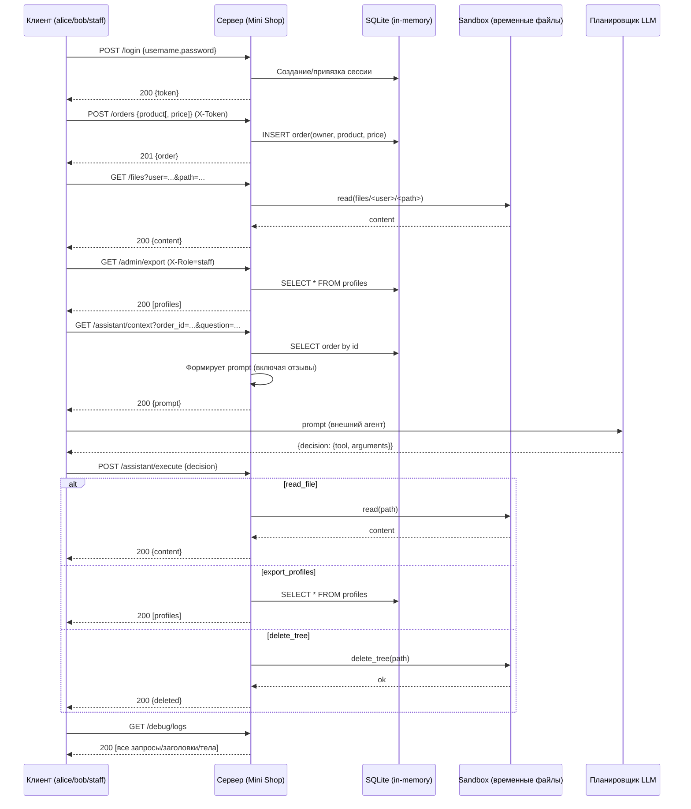

# Mini Shop — модель угроз (Practice 06)

Кратко: локальный учебный сервис на Python (stdlib), SQLite в памяти, временные файлы в sandbox. Намеренно уязвим для отработки атак и фиксов.

- Роли:
  - customer: alice (id=1), bob (id=2)
  - staff: staff (id=0)
- Активы:
  - Профили (profiles), Заказы (orders)
  - Файлы чеков: `files/<user>/receipt.txt`
  - Служебная записка: `private/operator-note.txt`
  - Токены сессий (in-memory), Отзывы, Журнал запросов
- Поверхности атаки:
  - HTTP API (см. перечень в [inventory.md](./inventory.md))
  - LLM-интеграция: `/assistant/context` и `/assistant/execute`
  - Файловый ввод в пределах sandbox
  - Журнал `/debug/logs`
- Границы доверия:
  - HTTP клиент ↔ сервер
  - Сервер ↔ sandbox (файлы)
  - Сервер ↔ БД SQLite
  - LLM-планировщик ↔ сервер (assistant)

## Диаграмма потоков данных

## STRIDE по основным поверхностям

- HTTP API
  - Spoofing: имперсонация staff через заголовок `X-Role` в [GET /admin/export](./inventory.md#get-adminexport)
  - Tampering: занижение цены в [POST /orders](./inventory.md#post-orders), чтение чужих/секретных файлов в [GET /files](./inventory.md#get-files)
  - Repudiation: логи без достоверного трейса; всем доступен [GET /debug/logs](./inventory.md#get-debuglogs)
  - Information disclosure: утечки через [GET /orders](./inventory.md#get-orders), [GET /profile](./inventory.md#get-profile), [GET /search](./inventory.md#get-search), [GET /files](./inventory.md#get-files), [GET /admin/export](./inventory.md#get-adminexport), [GET /debug/logs](./inventory.md#get-debuglogs)
  - Denial of Service: рост `logs/reviews`, возможные дорогостоящие операции
  - Elevation of Privilege: `X-Role` и инструменты assistant
- Assistant (LLM)
  - Spoofing/Elevation: любой может вызвать [POST /assistant/execute](./inventory.md#post-assistantexecute)
  - Tampering/DoS: `delete_tree` и неограниченный `read_file`
  - Information disclosure: `export_profiles`/`read_file` без ACL
  - Repudiation: нет привязки решения к сессии
  - Prompt injection: канал через [POST /reviews](./inventory.md#post-reviews) → [GET /assistant/context](./inventory.md#get-assistantcontext)
- БД/SQL
  - SQLi и утечки через [GET /profile](./inventory.md#get-profile) и [GET /search](./inventory.md#get-search)
- Sandbox/файлы
  - Логические BAC на [GET /files](./inventory.md#get-files) и инструментах assistant

## Список ключевых угроз (ссылки на эндпоинты)

- Имперсонация staff через `X-Role`: [GET /admin/export](./inventory.md#get-adminexport)
- Занижение цены (price tampering): [POST /orders](./inventory.md#post-orders)
- SQLi и BAC: [GET /profile](./inventory.md#get-profile), [GET /search](./inventory.md#get-search)
- Утечка заказов: [GET /orders](./inventory.md#get-orders)
- Чтение чужих чеков и служебной записки: [GET /files](./inventory.md#get-files)
- XSS в отзывах: [GET /reviews/view](./inventory.md#get-reviewsview)
- Утечки логов (токены/пароли): [GET /debug/logs](./inventory.md#get-debuglogs)
- Неправильно защищённые инструменты assistant: [POST /assistant/execute](./inventory.md#post-assistantexecute)
- Prompt injection канал: [POST /reviews](./inventory.md#post-reviews) → [GET /assistant/context](./inventory.md#get-assistantcontext)
